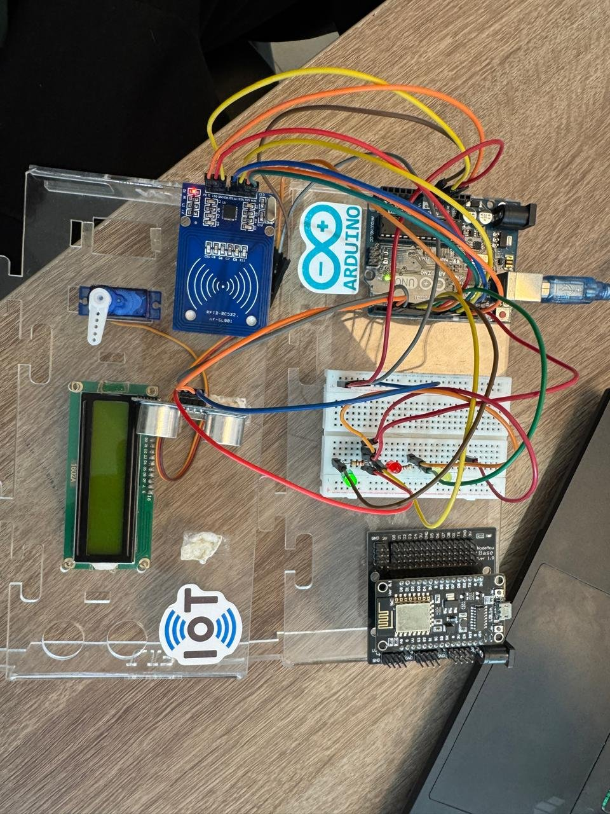
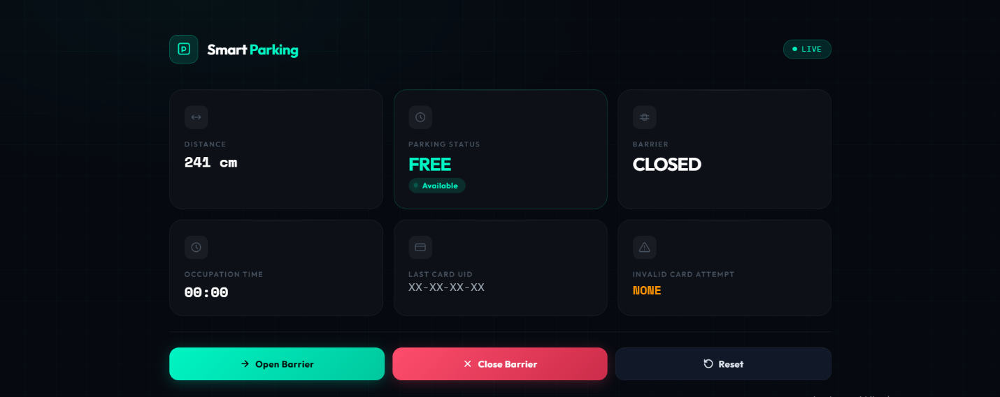
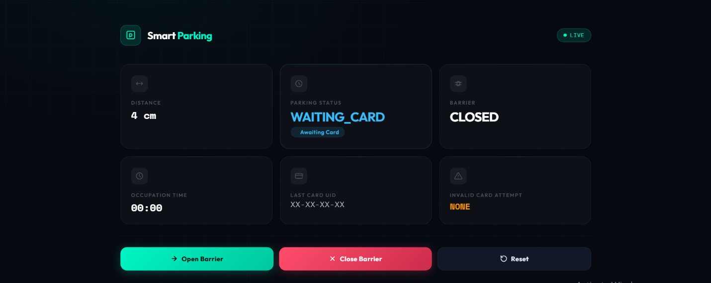
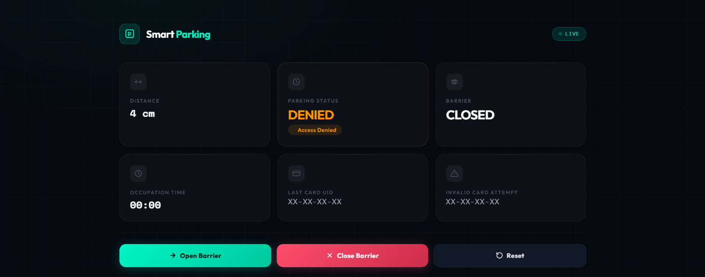
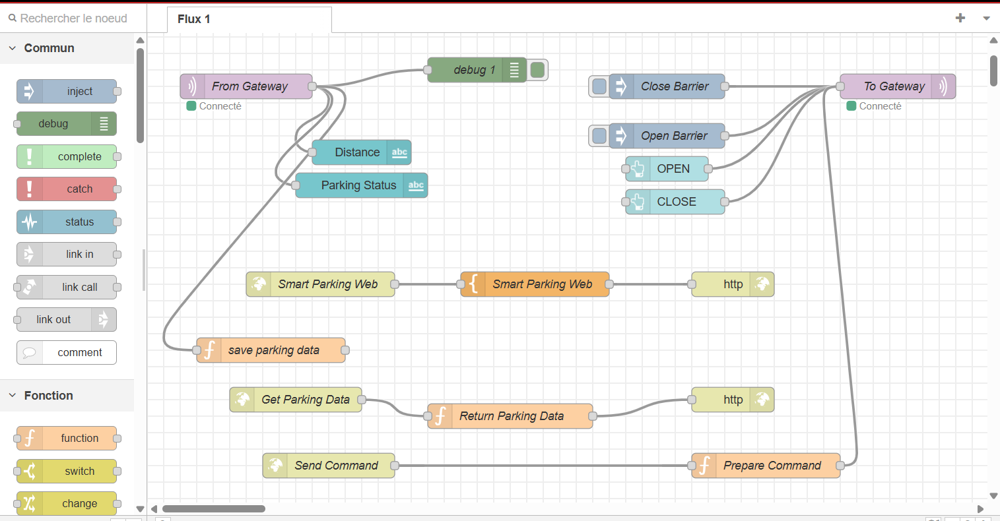

# Smart Parking — IoT Access Control

IoT parking access system: an **ultrasonic sensor** detects the vehicle, an **RFID badge** is checked by an **Arduino**, a **servo** opens the barrier, and a **Node-RED dashboard** shows the state in real time over **MQTT** and lets an operator open or close the barrier remotely.

Team project (4 students, Big Data & AI engineering program).

> **Repository content:** this repository contains the **Python serial ↔ MQTT gateway** and the project documentation (architecture, protocol, screenshots). The Arduino sketch and the Node-RED flow are not included.

| Hardware prototype | Live dashboard |
|---|---|
|  |  |

## Architecture

```
[Ultrasonic sensor]──┐
[RFID MFRC522]───────┼──► Arduino UNO ──USB serial──► Python gateway ──MQTT──► Node-RED
[Servo / LEDs]     ◄┘        ▲                            │   (broker)          ├─ dashboard (HTTP)
                              └──── OPEN / CLOSE ◄─────────┘◄──────────────────── └─ remote commands
```

1. The ultrasonic sensor measures the distance continuously. Below a threshold, a vehicle is considered present.
2. The system waits for an RFID badge. The Arduino compares its UID with a list of authorized cards.
3. Valid card: the servo opens the barrier and the state becomes `OCCUPIED`. Invalid card: the state becomes `DENIED` and the attempt is reported.
4. The Arduino sends a CSV telemetry line over serial: `distance,rfidStatus,parkingStatus,barrierStatus,lastCardUID,lastInvalidUID`.
5. The **gateway** (`gateway/gateway.py`) converts each line to JSON and publishes it on `<prefix>/telemetry`. It also forwards the commands it receives on `<prefix>/commands` (`OPEN` / `CLOSE`) to the Arduino.
6. **Node-RED** subscribes to the telemetry, serves the web dashboard and sends the commands.

Parking states: `FREE` · `WAITING_CARD` · `OCCUPIED` · `DENIED`. Barrier states: `OPEN` · `CLOSED`.

| Waiting for a badge | Access denied |
|---|---|
|  |  |

Node-RED flow:



## Hardware

Arduino UNO · ultrasonic distance sensor · MFRC522 RFID reader and badges · servo motor (barrier) · status LEDs (free / occupied / denied).

## Repository structure

```
gateway/     Python serial <-> MQTT gateway (this repository's code)
docs/images/ photos and screenshots of the prototype (RFID UIDs masked)
```

## Running the gateway

The gateway needs an Arduino that prints the telemetry line described above (`distance,rfidStatus,parkingStatus,barrierStatus,lastCardUID,lastInvalidUID`) and accepts `OPEN` / `CLOSE` on its serial port.

```bash
cd gateway
pip install -r requirements.txt
# set the variables listed in .env.example (MQTT_TOPIC_PREFIX, SERIAL_PORT, ...)
python gateway.py
```

Without `MQTT_TOPIC_PREFIX`, the gateway generates a random prefix and prints it. Any MQTT client (Node-RED, `mosquitto_sub`, ...) can then subscribe to `<prefix>/telemetry` and publish `OPEN` / `CLOSE` on `<prefix>/commands`.

## Security notes

- The default broker (`broker.hivemq.com`) is public. Anyone who knows the topic prefix can read the telemetry or send `OPEN`. Use a random private prefix, or your own broker with authentication.
- Authorized badge UIDs are masked in the screenshots.

## Possible improvements

- Store the access history in a database.
- Manage several parking spots.
- Add MQTT authentication and TLS.
- Build a mobile app for operators.
